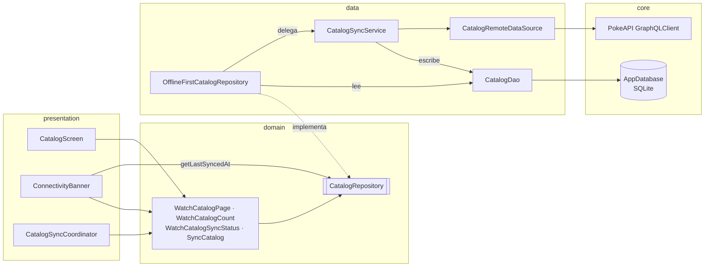
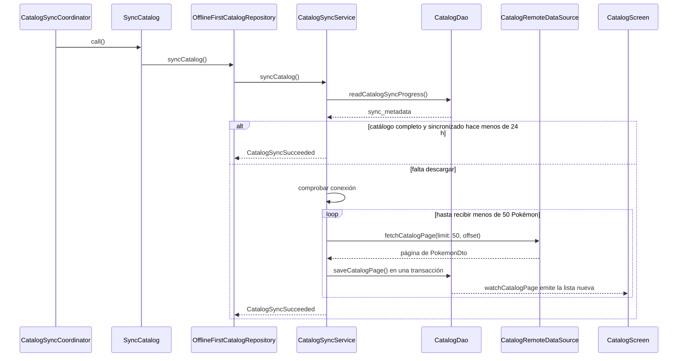
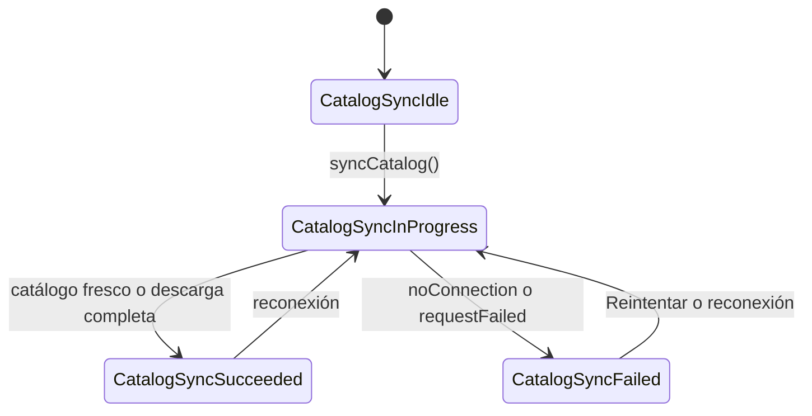
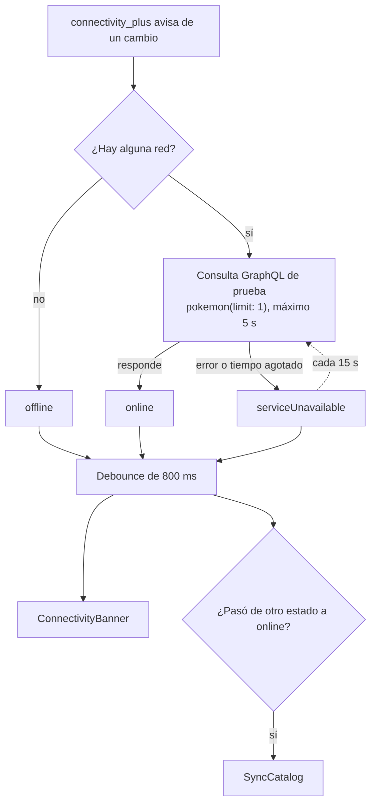
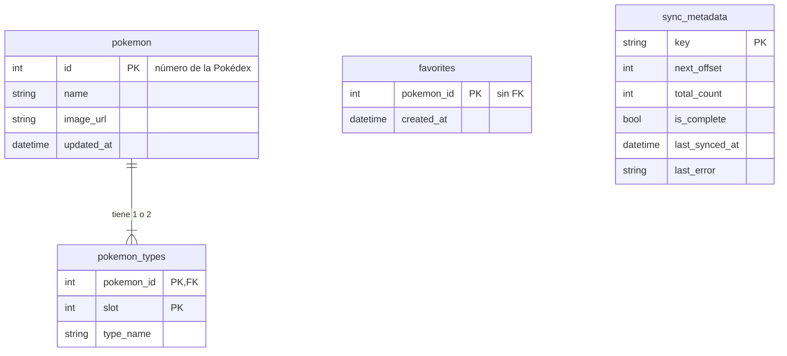

# Arquitectura

La app sigue una arquitectura por capas dentro de cada funcionalidad: `presentation` → `domain` ← `data`. La base SQLite local es la única fuente de datos de la interfaz; la red solo sirve para llenarla. Las decisiones que llevan a esto están en los ADRs:

- [ADR-0001: Base de datos local como única fuente de verdad](adr/0001-base-local-fuente-de-verdad.md)
- [ADR-0002: Drift sobre SQLite como base de datos local](adr/0002-drift-como-base-local.md)
- [ADR-0003: Riverpod para el estado y la inyección de dependencias](adr/0003-riverpod-para-estado-e-inyeccion.md)

## Estructura de carpetas

```text
lib/
  main.dart
  core/
    database/      AppDatabase y su provider
    network/       cliente GraphQL de PokeAPI y su provider
  features/
    catalog/
      data/        local (Drift), remote (GraphQL), sync, repositorio
      domain/      entidades, contrato CatalogRepository, casos de uso
      presentation/ pantallas, widgets, providers, CatalogSyncCoordinator
    connectivity/
      data/        ConnectivityService y repositorio
      domain/      ConnectivityStatus y contrato
      presentation/ ConnectivityBanner
    favorites/
      data/        tabla favorites (la interfaz llega en la entrega final)
```

## Capas y componentes

La interfaz nunca habla con la red. Lee `Stream`s que salen de `CatalogDao`, y la única pieza que toca GraphQL es `CatalogSyncService`, que escribe en la base. `main.dart` une `presentation` con `data` sobrescribiendo `catalogRepositoryProvider`.



## Sincronización al abrir la app

`main` llama a `runApp` sin esperar a la red. `CatalogSyncCoordinator` lanza la sincronización en segundo plano y la pantalla se redibuja sola cada vez que se guarda una página.



Si la descarga se corta, `sync_metadata.next_offset` guarda dónde se quedó y la siguiente sincronización continúa desde ahí.

## Estados de la sincronización

`CatalogSyncService` publica un `CatalogSyncStatus`. La pantalla y el banner lo leen para mostrar «Cargando catálogo», «Sincronizando...», el estado de error o el `SnackBar` de fallo.



## Conectividad

`ConnectivityService` no se fía solo del sistema operativo: tener Wi-Fi no garantiza que la API responda. Por eso distingue tres estados. `connectivityStatusProvider` ignora los cambios que duran menos de 800 ms, y `CatalogSyncCoordinator` sincroniza cuando el estado pasa a `online`.

Mientras el estado es `serviceUnavailable`, el servicio repite la consulta de prueba cada 15 s, porque la API puede volver sin que cambie la red. En cuanto responde, el estado pasa a `online` y el catálogo se sincroniza sin reiniciar la aplicación. En `online` y `offline` no repite la consulta.

La consulta de prueba espera como máximo 5 s, para que el banner reaccione rápido. Cada página del catálogo espera hasta 30 s (`catalogPageRequestTimeout`), porque trae 50 Pokémon con sus tipos y puede tardar más en una red móvil.



## Modelo de datos

`pokemon_types` se borra en cascada con su Pokémon. `favorites` no tiene clave foránea hacia `pokemon` a propósito, para que ninguna operación sobre el catálogo borre lo que marcó el usuario. `sync_metadata` tiene una fila por proceso de sincronización.


