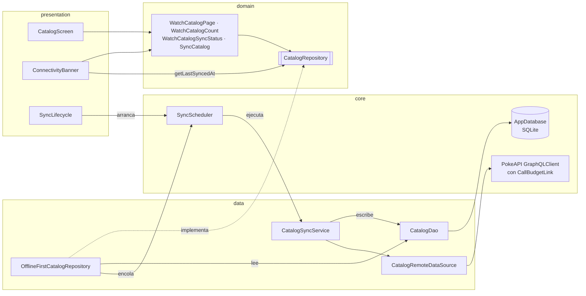
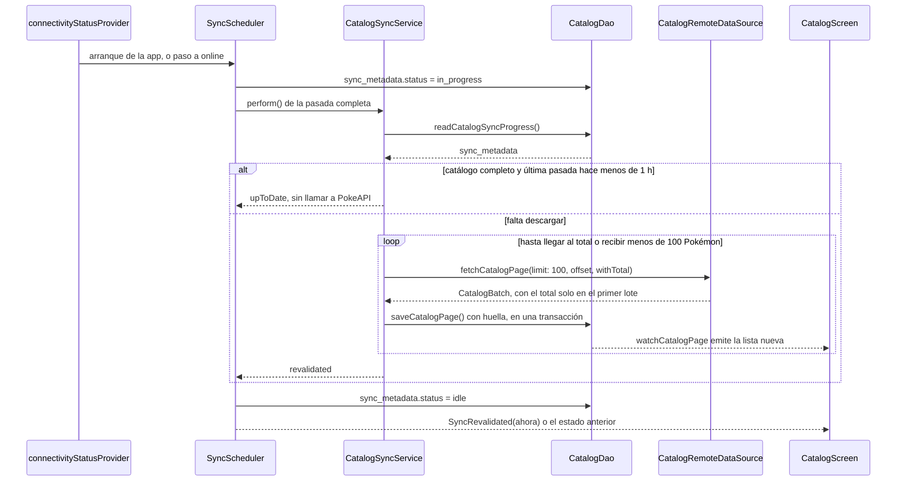
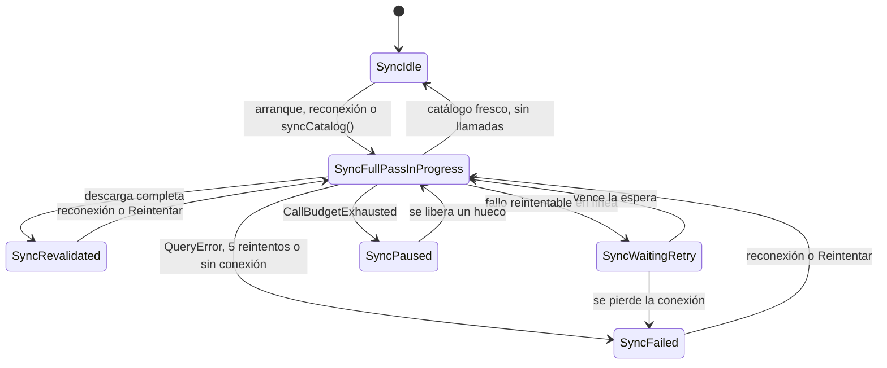
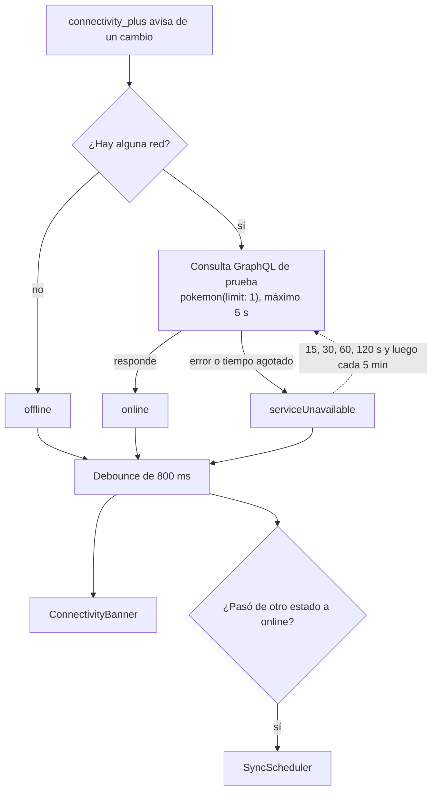
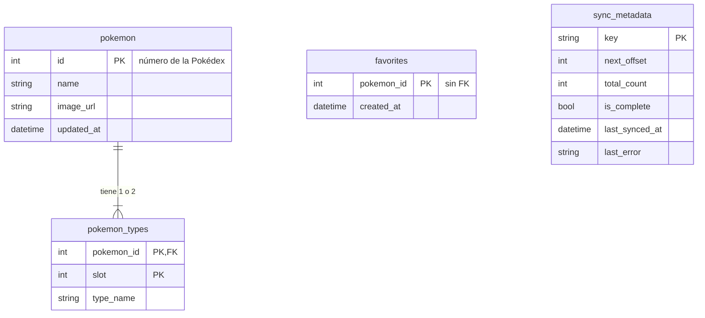

# Arquitectura

La app sigue una arquitectura por capas dentro de cada funcionalidad: `presentation` → `domain` ← `data`. La base SQLite local es la única fuente de datos de la interfaz; la red solo sirve para llenarla. Las decisiones que llevan a esto están en los ADRs:

- [ADR-0001: Base de datos local como única fuente de verdad](adr/0001-base-local-fuente-de-verdad.md)
- [ADR-0002: Drift sobre SQLite como base de datos local](adr/0002-drift-como-base-local.md)
- [ADR-0003: Riverpod para el estado y la inyección de dependencias](adr/0003-riverpod-para-estado-e-inyeccion.md)

## Estructura de carpetas

```text
lib/
  main.dart        arranque, MainApp y SyncLifecycle
  core/
    database/      AppDatabase y su provider
    network/       cliente GraphQL de PokeAPI, CallBudgetLink y su provider
    sync/          SyncScheduler y sus providers
      domain/      SyncFailure, SyncStatus, SyncJob, RetryPolicy, CallBudget
      data/        tabla sync_metadata, SyncMetadataDao, traductor de fallos
  features/
    catalog/
      data/        local (Drift), remote (GraphQL), sync, repositorio
      domain/      entidades, contrato CatalogRepository, casos de uso
      presentation/ pantallas, widgets, providers
    connectivity/
      data/        ConnectivityService y repositorio
      domain/      ConnectivityStatus y contrato
      presentation/ ConnectivityBanner
    favorites/
      data/        tabla favorites (la interfaz llega en la entrega final)
```

## Capas y componentes

La interfaz nunca habla con la red. Lee `Stream`s que salen de `CatalogDao`, y la única pieza del catálogo que toca GraphQL es `CatalogSyncService`, que escribe en la base. `SyncScheduler` decide cuándo corre cada sincronización y `CallBudgetLink` cuenta cada llamada antes de que salga a PokeAPI. `main.dart` une `presentation` con `data` sobrescribiendo `catalogRepositoryProvider`.



## Sincronización al abrir la app

`main` llama a `runApp` sin esperar a la red. `SyncLifecycle` arranca `SyncScheduler`, que lanza la pasada completa del catálogo al iniciar y otra vez cada vez que el estado pasa a `online`. Si al iniciar no hay conexión, la pasada queda pendiente hasta la reconexión; la pantalla se redibuja sola cada vez que se guarda un lote.



Si la descarga se corta, `sync_metadata.next_offset` guarda dónde se quedó y la siguiente sincronización continúa desde ahí.

## Estados de la sincronización

`SyncScheduler` publica un `SyncStatus` por recurso, un tipo sellado en Dart puro de `core/sync/domain`. La pantalla y el banner leen el del catálogo para mostrar «Cargando catálogo», «Sincronizando...», el estado de error o el `SnackBar` de fallo. El mismo estado queda en `sync_metadata.status` (`in_progress`, `waiting_retry`, `paused`, `pending`, `failed` o `idle`), con el intento, la hora del próximo reintento y el tipo del último fallo.

`SyncRevalidated` solo aparece cuando los datos acaban de llegar de PokeAPI en esta sesión. Si el catálogo está fresco y no hace falta llamar, el estado vuelve a `SyncIdle`, o a la última revalidación si ya hubo una.

Un fallo reintentable espera 2, 4, 8, 16 y 32 s (`RetryPolicy`) y después queda en `SyncFailed` hasta la siguiente reconexión o «Reintentar». Un 429 bloquea el presupuesto durante su `Retry-After`, o 10 min si no lo trae. Si se pierde la conexión durante una espera, el temporizador se cancela y la reconexión retoma el trabajo. Cada clave tiene un solo intento en curso: dos peticiones de la pasada completa comparten la misma descarga.



`SyncFailed` lleva el `SyncFailure` que explica el fallo. `data` lo traduce desde las excepciones de GraphQL, así que ni `presentation` ni `domain` conocen `OperationException`.

| Fallo | Cuándo ocurre | `isRetryable` |
| --- | --- | --- |
| `NoConnection` | No llega ninguna respuesta HTTP: sin red, DNS o conexión cortada | `false`; espera la reconexión |
| `RequestTimeout` | PokeAPI no responde dentro del límite de la consulta | `true` |
| `RateLimited` | HTTP 429, con su `Retry-After` en segundos si lo trae | `true` |
| `ServerError` | HTTP 5xx, aunque el cuerpo no sea JSON | `true` |
| `PartialResponse` | Llegan `data` y `errors` a la vez; no se guarda nada | `true` |
| `QueryError` | Llegan `errors` sin `data`, un HTTP 4xx o un error inesperado | `false` |
| `InvalidResponse` | El cuerpo no se puede leer o no trae la lista esperada | `true` |
| `CallBudgetExhausted` | `CallBudgetLink` no deja salir la llamada; nunca llega a la red | `true`; se pausa hasta que se libera un hueco |

`CallBudget` cuenta las llamadas de los últimos 60 min. Cada consulta lleva su prioridad en el `Context` de GraphQL: la salud y lo que pide el usuario pueden gastar hasta 80, las restauraciones hasta 70 y la pasada completa hasta 60, así que el catálogo nunca deja sin llamadas al usuario. Una consulta sin prioridad cuenta como segundo plano. El presupuesto vive en memoria y se reinicia si se cierra la app.

## Conectividad

`ConnectivityService` no se fía solo del sistema operativo: tener Wi-Fi no garantiza que la API responda. Por eso distingue tres estados. `connectivityStatusProvider` ignora los cambios que duran menos de 800 ms, y `SyncScheduler` relanza la pasada completa y los trabajos pendientes cuando el estado pasa a `online`.

Mientras el estado es `serviceUnavailable`, el servicio repite la consulta de prueba, porque la API puede volver sin que cambie la red. La espera crece con cada fallo seguido: 15, 30, 60 y 120 s, y luego cada 5 min. Así, una hora sin servicio gasta 16 de las 100 llamadas por hora que permite PokeAPI, en vez de 240. Un cambio de red vuelve a empezar en 15 s. En cuanto la API responde, el estado pasa a `online` y el catálogo se sincroniza sin reiniciar la aplicación. En `online` y `offline` no repite la consulta.

La consulta de prueba espera como máximo 5 s, para que el banner reaccione rápido. Cada lote del catálogo espera hasta 30 s (`catalogPageRequestTimeout`), porque trae 100 Pokémon con sus tipos y estadísticas y puede tardar más en una red móvil. La consulta de salud gasta del presupuesto con prioridad de usuario.



## Modelo de datos

`pokemon_types` se borra en cascada con su Pokémon. `favorites` no tiene clave foránea hacia `pokemon` a propósito, para que ninguna operación sobre el catálogo borre lo que marcó el usuario. `sync_metadata` tiene una fila por proceso de sincronización.


