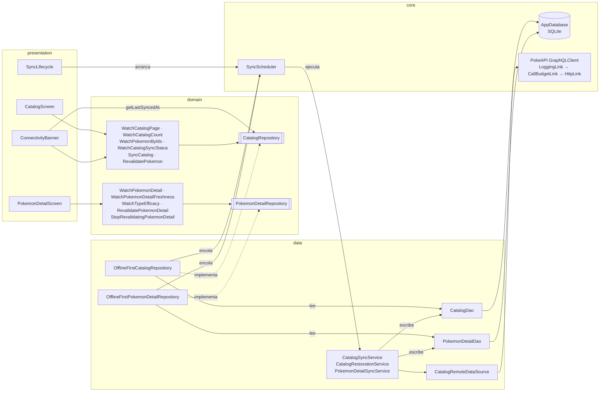
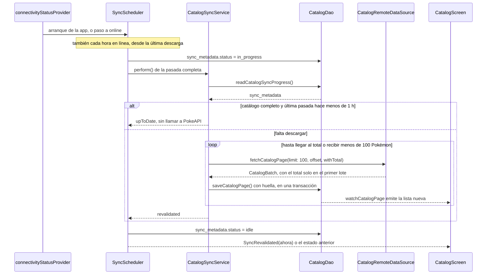
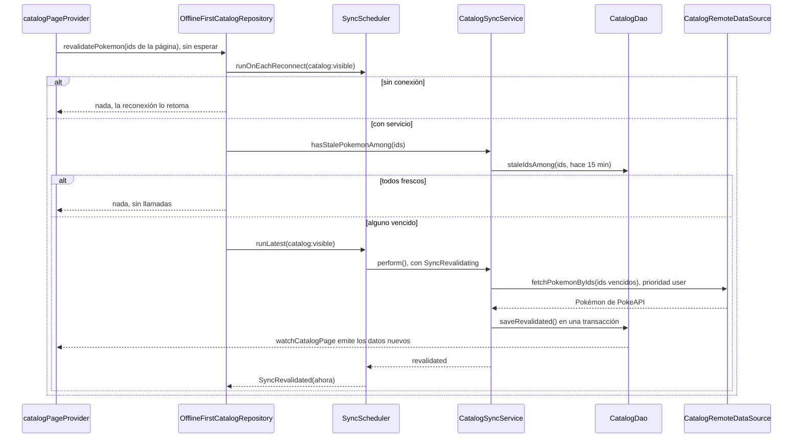
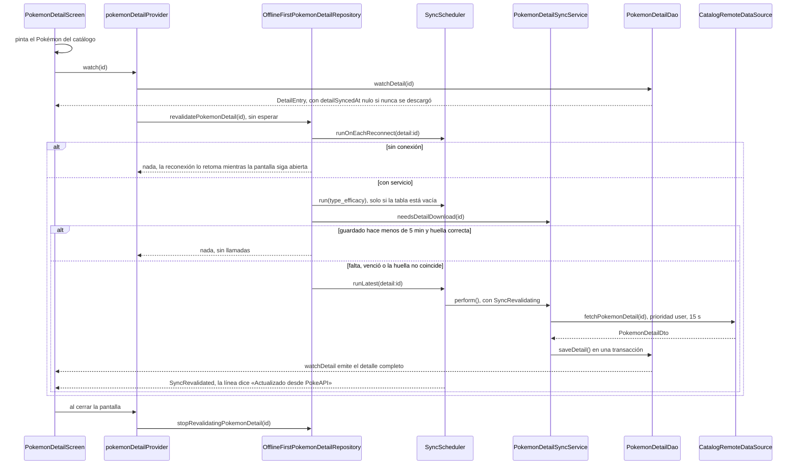
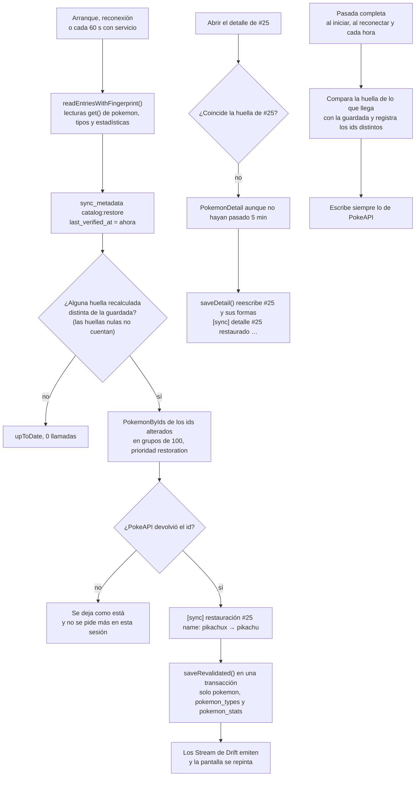
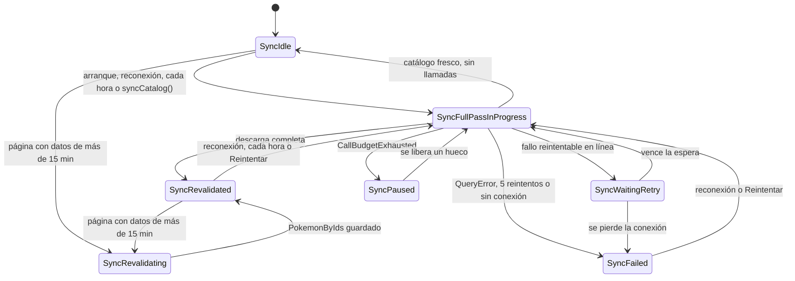
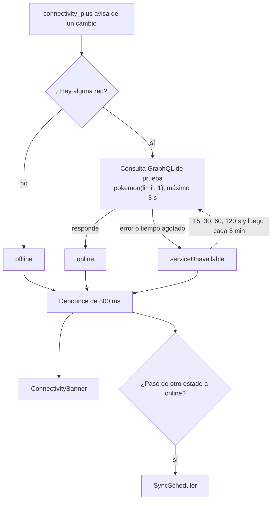
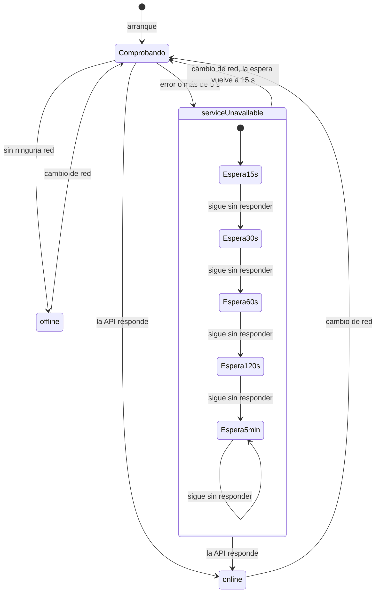
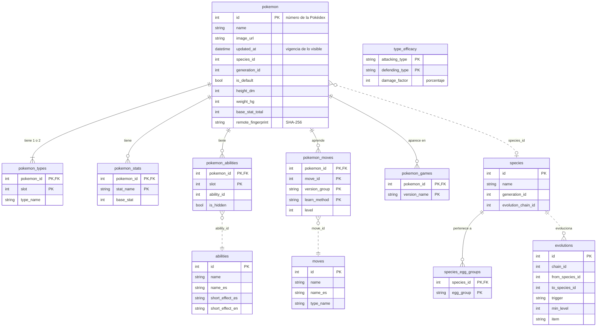
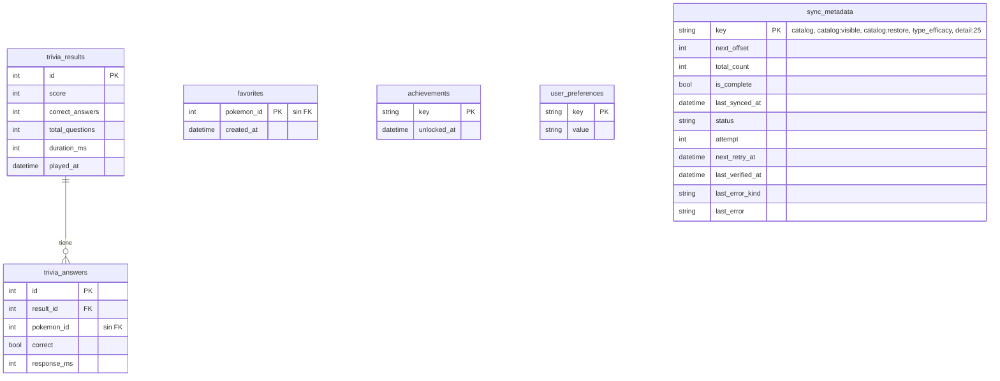

# Arquitectura

La app sigue una arquitectura por capas dentro de cada funcionalidad: `presentation` → `domain` ← `data`. La base SQLite local es la única fuente de datos de la interfaz; la red solo sirve para llenarla. Las decisiones que llevan a esto están en los ADRs:

- [ADR-0001: Base de datos local como única fuente de verdad](adr/0001-base-local-fuente-de-verdad.md)
- [ADR-0002: Drift sobre SQLite como base de datos local](adr/0002-drift-como-base-local.md)
- [ADR-0003: Riverpod para el estado y la inyección de dependencias](adr/0003-riverpod-para-estado-e-inyeccion.md)
- [ADR-0004: Reintentos con backoff, presupuesto de llamadas y una sola sincronización por recurso](adr/0004-reintentos-presupuesto-y-una-sincronizacion-por-recurso.md)
- [ADR-0005: Detección de alteraciones por huella y restauración desde PokeAPI](adr/0005-deteccion-de-alteraciones-y-restauracion.md)
- [ADR-0006: Preferencia online dentro del presupuesto](adr/0006-preferencia-online-dentro-del-presupuesto.md)

## Estructura de carpetas

```text
lib/
  main.dart        arranque, MainApp y SyncLifecycle
  core/
    database/      AppDatabase y su provider
    network/       cliente GraphQL de PokeAPI, LoggingLink, CallBudgetLink y su provider
    share/         provider para compartir texto con share_plus
    sync/          SyncScheduler y sus providers
      domain/      SyncFailure, SyncStatus, SyncJob, RetryPolicy, CallBudget
      data/        tabla sync_metadata, SyncMetadataDao, traductor de fallos
  features/
    catalog/
      data/        huella, diferencias, repositorios offline-first
        local/     CatalogDao, PokemonDetailDao, tablas del catálogo y del detalle
        remote/    consultas GraphQL, DTOs y mappers
        sync/      pasada completa, lo visible, restauración, detalle y tabla de tipos
      domain/
        entities/  Pokemon, PokemonDetail, árbol de evoluciones, matchups, vigencia, movimientos
        repositories/ contratos CatalogRepository y PokemonDetailRepository
        usecases/  casos de uso del catálogo y del detalle
      presentation/
        providers/ catálogo y detalle
        screens/   CatalogScreen y PokemonDetailScreen
        texts/     nombres y frases traducidos del catálogo y del detalle
        widgets/   lista del catálogo y, en detail/, el encabezado y las cinco pestañas
    connectivity/
      data/        ConnectivityService y repositorio
      domain/      ConnectivityStatus y contrato
      presentation/ ConnectivityBanner
    favorites/
      data/        tabla favorites, FavoritesDao y DriftFavoritesRepository
      domain/      contrato FavoritesRepository y casos de uso
      presentation/ FavoritesScreen, FavoriteButton y providers
    navigation/
      presentation/ MainNavigationScreen con NavigationBar
    settings/
      data/        tabla user_preferences, UserPreferencesDao y repositorio
      domain/      contrato SettingsRepository
      presentation/ SettingsScreen (idioma y tema) y providers
    trivia/
      data/        tablas trivia_results, trivia_answers y achievements
  l10n/            textos en ARB (español e inglés) y AppLocalizations generado
```

## Capas y componentes

La interfaz nunca habla con la red. Lee `Stream`s que salen de `CatalogDao` y `PokemonDetailDao`. Tres servicios de sincronización tocan GraphQL, todos a través de `CatalogRemoteDataSource`, y escriben en la base: `CatalogSyncService` (pasada completa y lo visible), `CatalogRestorationService` (huellas y restauración) y `PokemonDetailSyncService` (detalle y tabla de tipos). `SyncScheduler` decide cuándo corre cada uno. `LoggingLink` registra en consola cada consulta con sus variables y su duración, y `CallBudgetLink` la cuenta antes de que salga a PokeAPI. `main.dart` une `presentation` con `data` sobrescribiendo `catalogRepositoryProvider` y `pokemonDetailRepositoryProvider`.



## Sincronización al abrir la app

`main` llama a `runApp` sin esperar a la red. `SyncLifecycle` arranca `SyncScheduler` y `catalogSyncTriggersProvider`, que lanzan tres trabajos al iniciar y otra vez cada vez que el estado pasa a `online`: la pasada completa del catálogo, la verificación de huellas y la tabla de tipos. Cada uno decide si hace falta llamar a PokeAPI. Si al iniciar no hay conexión, quedan pendientes hasta la reconexión; la pantalla se redibuja sola cada vez que se guarda un lote. El diagrama sigue la pasada completa; la verificación de huellas está en «Detección y restauración por huella».

Mientras hay servicio, `runEveryWhileOnline` repite dos de ellos: la pasada completa cada hora (`catalogFullPassFreshness`) y la verificación de huellas cada 60 s. El temporizador se detiene sin conexión y vuelve a contar al reconectar. Además, cada descarga real (`SyncOutcome.revalidated`) lo reinicia, así que el periodo se cuenta desde la última descarga: cuando la pasada vuelve a correr, el catálogo ya tiene más de 1 h y se descarga, sin un «Sincronizando...» en vano.



Si la descarga se corta, `sync_metadata.next_offset` guarda dónde se quedó y la siguiente sincronización continúa desde ahí.

## Revalidación de lo visible

La pasada completa solo descarga si la última tiene más de 1 h, así que la página que se está viendo se revalida aparte. `catalogPageProvider` llama a `RevalidatePokemon` con los ids de la página la primera vez que la página trae Pokémon y cada vez que vuelve a mostrarse. No espera la respuesta: si llegan datos nuevos, entran por la base y `watchCatalogPage` vuelve a emitir.

- **Sin conexión** no se hace nada. El repositorio deja la petición registrada con `runOnEachReconnect` y `SyncScheduler` la repite en la siguiente reconexión.
- **Con servicio** solo se llama si algún id tiene `pokemon.updated_at` de hace más de 15 min (`visibleFreshnessWindow`). Si todos están frescos, no hay llamada ni cambio de estado.
- **Una sola consulta** `PokemonByIds` trae los ids vencidos con prioridad de usuario, bajo la clave `catalog:visible`. `saveRevalidated` los guarda en una transacción con `_upsertEntries`, sin tocar el progreso de la pasada completa.
- **`force`** (deslizar para actualizar, en la fase 2) pide todos los ids aunque estén frescos.
- **`runLatest`**: si llega una petición mientras otra de lo visible está en curso, espera a que termine, y una más nueva la reemplaza. Así, al pasar páginas rápido solo se descarga la última.



## Abrir un detalle

`PokemonDetailScreen` pinta al instante el Pokémon que recibió del catálogo (OF-03): nombre, número, tipos e imagen. `pokemonDetailProvider` observa `PokemonDetailDao.watchDetail(id)`, que emite aunque el detalle nunca se haya descargado: las estadísticas, la altura y el peso ya vienen del catálogo. En la primera emisión pide la revalidación, sin esperarla. Si llega algo nuevo, entra por la base y la pantalla se repinta.

- **Cuándo se descarga.** Con servicio, si no hay detalle guardado, si se guardó hace más de 5 min (`detailFreshnessWindow`) o si la huella del Pokémon no coincide (ADR-0005). Deslizar hacia abajo fuerza la descarga.
- **Una consulta.** `PokemonDetail` trae en una sola llamada la especie, la cadena de evolución completa, las formas, las habilidades, los movimientos y los juegos. Tiene prioridad de usuario y un tiempo límite de 15 s (`detailRequestTimeout`). `saveDetail` lo guarda todo en una transacción.
- **Tabla de tipos.** Si está vacía, se descarga a la vez con prioridad de usuario. Los matchups se calculan en el dominio a partir de ella.
- **Vigencia.** La línea bajo el nombre dice «Actualizado desde PokeAPI» solo si `detail:{id}` se descargó en esta sesión. Si no, «Datos locales del …» o «Sin detalle guardado».
- **Al cerrar.** `StopRevalidatingPokemonDetail` quita el trabajo de la lista de reconexión, para no descargar en cada reconexión un detalle que ya nadie mira.



Elegir una forma en el selector cambia el id observado: la pantalla pinta los campos de esa forma, que ya están en el catálogo, y su detalle se descarga igual, bajo demanda.

## Detección y restauración por huella

Cada Pokémon se guarda con `remote_fingerprint`, el SHA-256 de sus datos tal como llegaron de PokeAPI (ADR-0005). Verificar consiste en recalcular la huella con los datos locales y compararla con la guardada, sin llamar a PokeAPI. Solo los Pokémon que no coinciden se vuelven a pedir.



- **El valor de PokeAPI siempre gana.** No se fusiona nada con lo local.
- **Lo del usuario no se toca.** `favorites`, `trivia_results`, `trivia_answers`, `achievements` y `user_preferences` no tienen clave foránea hacia el catálogo, y la restauración no las escribe (OF-21).
- **Fuera del banner.** La clave `catalog:restore` no entra en el estado del catálogo: restaurar un Pokémon no es «lo que se está viendo», y una verificación por minuto haría parpadear el banner. La prueba de PA-16 es la consola.
- **El inspector no repinta.** Un `UPDATE` hecho con la extensión de Drift para DevTools no avisa a los `Stream`s, así que la pantalla sigue mostrando el valor anterior hasta que la restauración escribe.
- **Costo.** 0 llamadas si nada cambió, y 1 por cada 100 Pokémon alterados, con tope 70 para no quitar llamadas al usuario.

## Estados de la sincronización

`SyncScheduler` publica un `SyncStatus` por recurso, un tipo sellado en Dart puro de `core/sync/domain`. La pantalla y el banner leen el del catálogo para mostrar «Cargando catálogo», «Sincronizando...», el estado de error o el `SnackBar` de fallo. Ese estado junta las claves `catalog` y `catalog:visible` con `mostRelevantSyncStatus`, que elige, en este orden: pasada completa en curso, revalidando, esperando reintento, en pausa, fallo, revalidado (la hora más reciente) y reposo. El mismo estado queda en `sync_metadata.status` (`in_progress`, `waiting_retry`, `paused`, `pending`, `failed` o `idle`), con el intento, la hora del próximo reintento y el tipo del último fallo.

`SyncRevalidated` solo aparece cuando los datos acaban de llegar de PokeAPI en esta sesión. Si el catálogo está fresco y no hace falta llamar, el estado vuelve a `SyncIdle`, o a la última revalidación si ya hubo una.

Un fallo reintentable espera 2, 4, 8, 16 y 32 s (`RetryPolicy`) y después queda en `SyncFailed` hasta la siguiente reconexión o «Reintentar». Un 429 bloquea el presupuesto durante su `Retry-After`, o 10 min si no lo trae. Si se pierde la conexión durante una espera, el temporizador se cancela y la reconexión retoma el trabajo. Cada clave tiene un solo intento en curso: dos peticiones de la pasada completa comparten la misma descarga, y lo visible usa `runLatest` para que la petición más nueva espere a la que está en curso.



La revalidación de lo visible, el detalle (`detail:{id}`), la tabla de tipos (`type_efficacy`) y la restauración (`catalog:restore`) pasan por los mismos reintentos, pausas y fallos que la pasada completa, cada uno con su clave. Mientras corren publican `SyncRevalidating`. El banner solo lee `catalog` y `catalog:visible`; la línea de vigencia del detalle lee `detail:{id}`.

`SyncFailed` lleva el `SyncFailure` que explica el fallo. `data` lo traduce desde las excepciones de GraphQL, así que ni `presentation` ni `domain` conocen `OperationException`.

| Fallo | Cuándo ocurre | `isRetryable` |
| --- | --- | --- |
| `NoConnection` | No llega ninguna respuesta HTTP: sin red, DNS o conexión cortada | `false`; espera la reconexión |
| `RequestTimeout` | PokeAPI no responde dentro del límite de la consulta | `true` |
| `RateLimited` | HTTP 429, con su `Retry-After` en segundos si lo trae | `true` |
| `ServerError` | HTTP 5xx, aunque el cuerpo no sea JSON | `true` |
| `PartialResponse` | Llegan `data` y `errors` a la vez; no se guarda nada | `true` |
| `QueryError` | Llegan `errors` sin `data`, un HTTP 4xx o un error inesperado | `false` |
| `InvalidResponse` | El cuerpo no se puede leer o no trae la lista esperada | `true` |
| `CallBudgetExhausted` | `CallBudgetLink` no deja salir la llamada; nunca llega a la red | `true`; se pausa hasta que se libera un hueco |

`CallBudget` cuenta las llamadas de los últimos 60 min. Cada consulta lleva su prioridad en el `Context` de GraphQL: la salud y lo que pide el usuario pueden gastar hasta 80, las restauraciones hasta 70 y la pasada completa hasta 60, así que el catálogo nunca deja sin llamadas al usuario. Una consulta sin prioridad cuenta como segundo plano. El presupuesto vive en memoria y se reinicia si se cierra la app.

## Conectividad

`ConnectivityService` no se fía solo del sistema operativo: tener Wi-Fi no garantiza que la API responda. Por eso distingue tres estados. `connectivityStatusProvider` ignora los cambios que duran menos de 800 ms, y `SyncScheduler` relanza la pasada completa, los trabajos pendientes y la última revalidación de lo visible cuando el estado pasa a `online`.

Mientras el estado es `serviceUnavailable`, el servicio repite la consulta de prueba, porque la API puede volver sin que cambie la red. La espera crece con cada fallo seguido: 15, 30, 60 y 120 s, y luego cada 5 min. Así, una hora sin servicio gasta 16 de las 100 llamadas por hora que permite PokeAPI, en vez de 240. Un cambio de red vuelve a empezar en 15 s. En cuanto la API responde, el estado pasa a `online` y el catálogo se sincroniza sin reiniciar la aplicación. En `online` y `offline` no repite la consulta.

La consulta de prueba espera como máximo 5 s, para que el banner reaccione rápido. Cada lote del catálogo espera hasta 30 s (`catalogPageRequestTimeout`), porque trae 100 Pokémon con sus tipos y estadísticas y puede tardar más en una red móvil. El detalle espera hasta 15 s (`detailRequestTimeout`): la respuesta de Pikachu pesa unos 13 KB comprimidos y tardó menos de 1 s en las pruebas. La consulta de salud gasta del presupuesto con prioridad de usuario.



### Máquina de estados de la disponibilidad

El estado de la disponibilidad solo cambia tras una consulta de prueba. Mientras dura la consulta no se publica nada nuevo y el banner sigue con el estado anterior. Las esperas de `serviceUnavailable` crecen con cada fallo seguido y vuelven a 15 s cuando cambia la red.



## Modelo de datos

El esquema 2 tiene 18 tablas. La migración desde la versión 1 (`stepByStep`) añade las columnas y tablas nuevas y deja en nulo el `last_synced_at` del catálogo, para que la siguiente pasada complete los campos nuevos. Las filas antiguas quedan con `remote_fingerprint` nulo.

Las reglas que hay que saber defender:

- **Cascada solo desde `pokemon`, `species` y `trivia_results`.** Las filas que dependen de un Pokémon se borran con él. Ninguna clave foránea apunta a `abilities` ni a `moves`, así que el orden de inserción no importa.
- **Upsert con `ON CONFLICT DO UPDATE`, nunca `INSERT OR REPLACE`.** REPLACE borra la fila antes de insertarla, y la cascada se llevaría sus tipos y estadísticas.
- **Lo del usuario no depende del catálogo.** `favorites` y `trivia_answers` guardan el número del Pokémon sin clave foránea, para que ninguna operación sobre el catálogo borre lo que hizo el usuario.
- **Una fila de `sync_metadata` por clave.** `catalog`, `catalog:visible`, `catalog:restore`, `type_efficacy` y cada `detail:{id}` tienen su estado, su intento y su último fallo. `last_synced_at` de `detail:{id}` es la hora de la última descarga del detalle, y `last_verified_at` de `catalog:restore`, la de la última verificación de huellas.
- **Las formas son filas de `pokemon`.** Una forma regional tiene `is_default = false` y el mismo `species_id`; el catálogo solo muestra las filas por defecto.

Catálogo y detalle. Las líneas punteadas son relaciones sin clave foránea.



Usuario y sincronización.



`evolutions` guarda también la hora del día, el lugar, la felicidad mínima y el tipo de movimiento que piden algunas evoluciones; el diagrama muestra solo las columnas principales.

Índices (RNF-REN-02):

| Índice | Columnas | Consulta que acelera |
| --- | --- | --- |
| `pokemon_name_nocase` | `pokemon(name COLLATE NOCASE)` | Búsqueda por prefijo del nombre y orden alfabético |
| `pokemon_generation_id` | `pokemon(generation_id)` | Filtro por generación |
| `pokemon_base_stat_total` | `pokemon(base_stat_total)` | Orden por total base |
| `pokemon_species_id` | `pokemon(species_id)` | Formas de una especie en el detalle |
| `pokemon_types_by_type` | `pokemon_types(type_name, pokemon_id)` | Filtro por tipo |
| `pokemon_moves_by_version_and_method` | `pokemon_moves(pokemon_id, version_group, learn_method)` | Movimientos del detalle por juego y método |
| `trivia_results_by_score` | `trivia_results(score)` | Ranking local |
